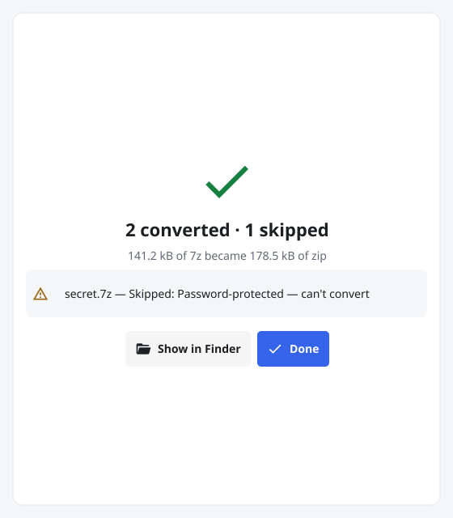

# ZipMaker

Batch-convert `.7z` archives to `.zip` on macOS and Windows. Drop a folder of `.7z` files on the
window, click **Convert**, and get verified `.zip` files beside the originals. No installer and no
7-Zip needed.

<picture>
  <source media="(prefers-color-scheme: dark)" srcset="screenshots/finished-dark.png">
  
</picture>

## Download

Get the latest version from the **[Releases page](../../releases/latest)**:

| Platform | File |
|---|---|
| macOS 12+ (Apple Silicon and Intel) | `ZipMaker-mac.zip` |
| Windows 10/11 (64-bit) | `ZipMaker.exe` |

`SHA256SUMS.txt` lists each file's checksum if you want to verify your download.

## Install and run

### macOS
1. Unzip `ZipMaker-mac.zip` and move `ZipMaker.app` to Applications (or anywhere you like).
2. First launch: the app isn't notarized by Apple, so macOS blocks it the first time.
   - **macOS 15 (Sequoia) and later:** double-click it and dismiss the warning, then open
     **System Settings → Privacy & Security**, scroll to Security, click **Open Anyway** next to
     the ZipMaker message and confirm with **Open**.
   - **macOS 12–14:** right-click the app → **Open**, then **Open** again.
3. After that, double-click it normally.

### Windows
1. Run `ZipMaker.exe`. It's portable: there's nothing to install.
2. If SmartScreen appears, click **More info** → **Run anyway**.

## What it does

- Keeps your `.7z` files unless you tick **Delete .7z after verifying**, and only deletes one after
  its zip has been checked against the original.
- Never overwrites an existing `.zip`.
- Skips encrypted and multi-part archives and tells you which ones it skipped.
- Also has a command line (options: `--recursive`, `--delete-source`, `--jobs N`):
  - macOS: `ZipMaker.app/Contents/MacOS/zipmaker --cli ~/archives`
  - Windows cmd: `start /wait ZipMaker.exe --cli D:\archives`
  - Windows PowerShell: `.\ZipMaker.exe --cli D:\archives | Out-Default`

  (Windows shells don't wait for windowed programs, so the extra part keeps the output in your
  console.)

This repository only hosts the downloads.
